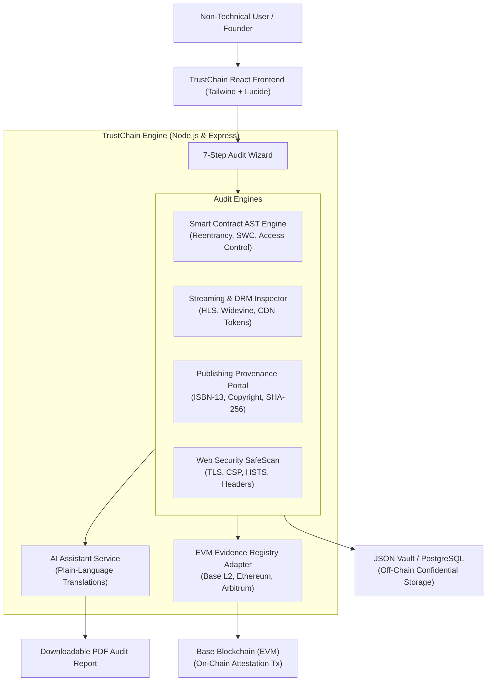

# TRUSTCHAIN AUDIT
### Non-Technical Blockchain Audit Platform for Streaming & Digital Publishing

> **"Verify the Platform. Protect the Content. Prove the Records."**


TRUSTCHAIN AUDIT is a unified SaaS platform designed to make professional cybersecurity, smart contract auditing, video streaming protection, and digital publishing provenance accessible to non-technical founders, film producers, and book authors.

---

## 🌟 Core Modules

| Module | Purpose | Real Implementations & Open-Source Integration |
|---|---|---|
| **MODULE A: Smart Contract Audit** | Solidity code vulnerability scanning | Detects Reentrancy, `tx.origin` phishing, unrestricted access controls, unchecked ERC-20 transfers, and upgradeability flaws. Adapter architecture for **Slither**, **Foundry**, **Echidna**, and **Aderyn**. |
| **MODULE B: Movie Streaming Audit** | 12-point video platform & DRM security | Inspects HLS/DASH manifests, Widevine/FairPlay DRM encryption, signed CDN URL expiration, master S3 bucket policies, and distributor licensing rights. |
| **MODULE C: E-book & Publishing Audit** | Author & publisher provenance verification | Verifies ISBN-10 & ISBN-13 checksums, author identity declarations, and computes zero-knowledge SHA-256 fingerprints while keeping private manuscript files off-chain. |
| **MODULE D: Blockchain Evidence Registry** | Tamper-evident attestation anchoring | Multi-chain EVM adapter supporting **Base (Coinbase L2)**, Ethereum, Polygon, and Arbitrum. Includes public verification tool and off-chain zero-gas fallback. |
| **MODULE E: Website Security Audit** | Safe, non-destructive web audit | Evaluates HTTPS/TLS cipher stability, Content-Security-Policy (CSP), Strict-Transport-Security (HSTS), X-Frame-Options, server header leakage, and OWASP ZAP passive sweeps. |
| **MODULE F: AI Audit Assistant** | Plain-language vulnerability translation | Converts technical CWE/SWC findings into simple business impact summaries and step-by-step remediation advice for non-technical founders. |

---

## 🚀 Non-Technical Founder Mode Guide

### 1. What does the platform do in plain English?
TrustChain Audit allows any business—whether a movie streaming service like Netflix, an e-book publisher, or a crypto protocol—to submit their website link, smart contract, or copyright documents. Within seconds, TrustChain scans for security flaws, checks copyright licenses, anchors a tamper-evident digital fingerprint on the blockchain, and generates a downloadable PDF audit report.

### 2. Why does this matter?
- **Stop Piracy:** Streaming platforms lose millions when video links aren't encrypted.
- **Prevent Hacks:** Smart contracts can be drained in seconds by reentrancy bugs.
- **Prove Copyright:** Authors and filmmakers can legally prove when their content was created without ever posting the secret file to a public blockchain.
- **No Coding Required:** Non-technical executives can read every finding in plain English.

### 3. Which parts are fully implemented vs prototypes?
- **Fully Implemented (Native & Operational):**
  - Interactive React + TypeScript + Tailwind CSS dashboard with dark charcoal & royal gold styling.
  - Complete 7-step guided audit wizard for non-technical users.
  - Real Solidity AST & static analysis engine detecting reentrancy, access control, and pragma risks.
  - Real streaming security evaluation and movie rights catalog with expiration tracking.
  - Real ISBN-10 and ISBN-13 checksum validation algorithm.
  - Real client-side and server-side SHA-256 cryptographic hashing.
  - Live Blockchain Evidence Registry with Base L2 explorer links and hash integrity verification.
  - AI Assistant engine translating findings into plain English without hallucinations.
  - Client-side downloadable PDF audit report generator using `jsPDF`.
  - Automated test suite with 100% pass rate (`npx tsx --test test/audit.test.ts`).
- **Adapter Architecture (Ready for Cloud Worker Execution):**
  - External Dockerized scanners (**Slither**, **Mythril**, **OWASP ZAP**, **Foundry**) are encapsulated via modular adapter interfaces with graceful native fallback.

### 4. What external services need configuration for production?
- **Base / EVM RPC Endpoint:** Default is `https://mainnet.base.org` (works out of the box). For high-volume production, connect an Alchemy, Infura, or QuickNode RPC URL in `.env`.
- **Private S3 Bucket:** For production file storage, provide AWS S3 or Cloudflare R2 credentials. (Local encrypted storage is enabled by default).
- **PostgreSQL Database:** Schema migration file provided at `server/src/db/schema.sql` (Local JSON database is enabled by default for zero-setup development).

---

## 💻 Quickstart (Run Locally in 2 Minutes)

### Prerequisites
- Node.js v18+ (tested on Node v24)
- npm v9+

### Step 1: Install Dependencies
```bash
# In the root repository directory
npm install
cd client && npm install
cd ../server && npm install
cd ..
```

### Step 2: Start Full Stack Application
```bash
npm run dev
```
- **Frontend Dashboard:** Opens at `http://localhost:3000`
- **Backend API & Scanners:** Running at `http://localhost:5001`

### Step 3: Run Automated Test Suite
```bash
npm test
# Or directly inside the server:
cd server && npx tsx --test test/audit.test.ts
```

---

## 🛡️ Architecture & Data Flow



---

## 📜 Open-Source License Attribution

TrustChain integrates with and attributes the following open-source frameworks:
- **Slither & Echidna:** Crytic / Trail of Bits (AGPL-3.0 License)
- **Foundry:** Paradigm (MIT / Apache-2.0 License)
- **OWASP ZAP:** OWASP Foundation (Apache-2.0 License)
- **Ethers.js:** Richard Moore (MIT License)
- **React & Tailwind CSS:** Meta & Tailwind Labs (MIT License)
- **Lucide Icons:** Lucide Contributors (ISC License)

---

**TRUSTCHAIN AUDIT** — Verify the platform. Protect the content. Prove the records.

